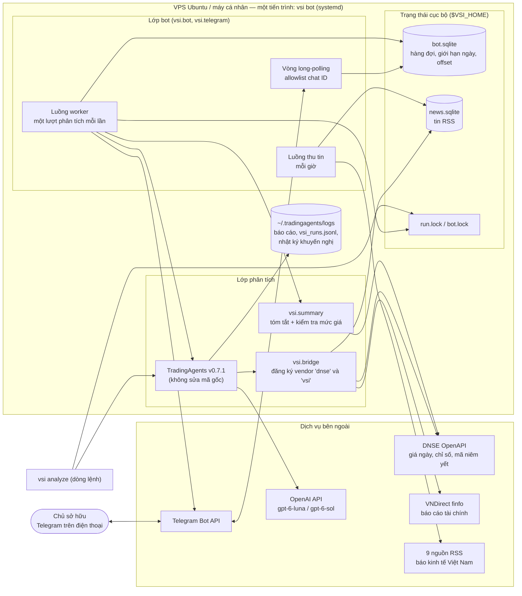
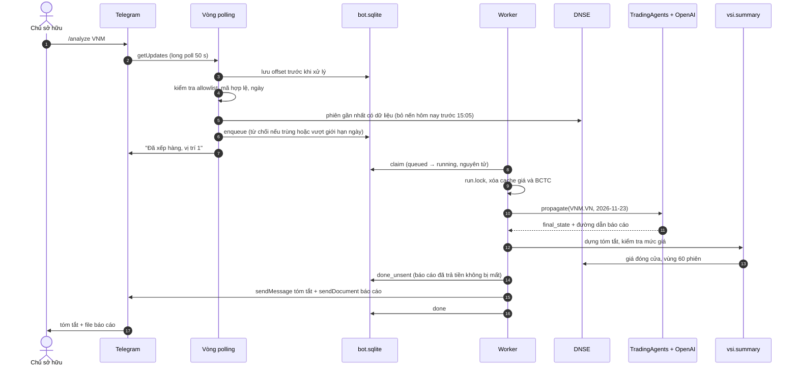
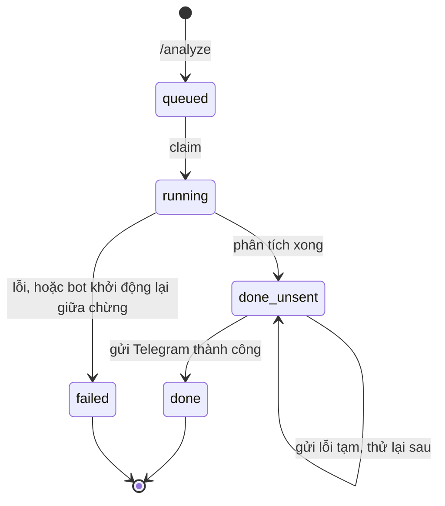
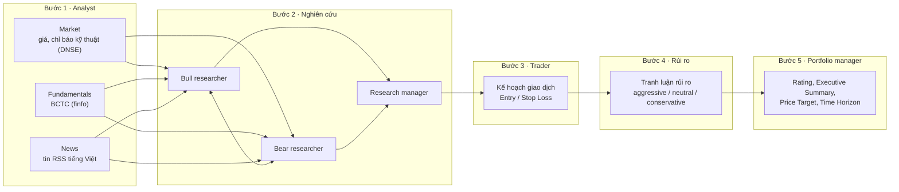

# Vietnam Stock Intelligence (VSI)

Nền tảng **nghiên cứu** cổ phiếu Việt Nam (HOSE, HNX, UPCoM) cho swing trade 5–20 phiên. Một đội agent AI
([TradingAgents](https://github.com/TauricResearch/TradingAgents) v0.7.1) đọc giá, báo cáo tài chính và tin
tức tiếng Việt, rồi viết báo cáo. Bạn ra lệnh và nhận kết quả qua Telegram.

> **Chỉ để nghiên cứu.** Hệ thống không đặt lệnh, không kết nối tài khoản giao dịch, không hứa lợi nhuận.
> Xếp hạng của agent **chưa được kiểm chứng**. Mọi quyết định mua bán do bạn tự làm trên app của công ty chứng khoán.

## Mục lục

- [Kiến trúc hệ thống](#kiến-trúc-hệ-thống)
- [Luồng một lệnh `/analyze`](#luồng-một-lệnh-analyze)
- [Đội agent bên trong một lượt phân tích](#đội-agent-bên-trong-một-lượt-phân-tích)
- [Các module](#các-module)
- [Nguồn dữ liệu](#nguồn-dữ-liệu)
- [Cài đặt](#cài-đặt)
- [Sử dụng](#sử-dụng)
- [Bảo mật và an toàn chi phí](#bảo-mật-và-an-toàn-chi-phí)
- [Chi phí](#chi-phí)
- [Giới hạn đã biết](#giới-hạn-đã-biết)
- [Lộ trình](#lộ-trình)
- [Tài liệu](#tài-liệu)

## Kiến trúc hệ thống



Ba ý chính:

1. **Một tiến trình, không async, không thêm thư viện.** `vsi bot` chạy ba luồng: luồng nhận lệnh từ
   Telegram, luồng chạy phân tích, luồng thu tin mỗi giờ. Tất cả dùng `requests` và `threading`.
2. **TradingAgents giữ nguyên.** `vsi.bridge` cắm nguồn dữ liệu Việt Nam vào bộ định tuyến vendor của
   TradingAgents và chặn Yahoo. Công cụ không có nguồn Việt Nam (giao dịch nội bộ, vĩ mô, thị trường dự đoán)
   trả về "không có dữ liệu" thay vì lấy dữ liệu Mỹ.
3. **Mỗi lần chỉ một lượt có phí.** Hàng đợi SQLite, khóa file `run.lock` dùng chung giữa bot và
   `vsi analyze`, khóa `bot.lock` chặn chạy hai bot, giới hạn số lượt mỗi ngày.

## Luồng một lệnh `/analyze`



Trạng thái một việc trong hàng đợi:



Việc đang `running` khi bot bị tắt sẽ thành `failed` lúc khởi động lại và **không tự chạy lại**, vì chạy
lại tốn tiền. Bạn gửi lại lệnh nếu cần.

## Đội agent bên trong một lượt phân tích

Đây là quy trình của TradingAgents. VSI chỉ bật ba analyst có nguồn dữ liệu Việt Nam.



Báo cáo đầy đủ lưu theo đúng năm bước này trong thư mục `1_analysts` … `5_portfolio`, kèm
`complete_report.md` và `complete_report.html`.

**Bản tóm tắt gửi Telegram** tách rõ dữ kiện và ý kiến:

- Dòng dữ liệu: giá DNSE đến ngày nào, BCTC quý nào và ngày công bố, tin tức thu từ ngày nào.
- Giá đóng cửa và biên độ sàn: HOSE ±7%, HNX ±10%, UPCoM ±15%. Với UPCoM, biên độ được ghi là ước tính,
  vì giá tham chiếu thật là bình quân gia quyền phiên trước.
- Mức vào lệnh, cắt lỗ, mục tiêu **được code kiểm tra**. Mức vào lệnh phải nằm trong biên độ phiên tới;
  cắt lỗ và mục tiêu phải nằm trong vùng giá 60 phiên, nới thêm một biên độ. Mức sai bị bỏ và chỉ ghi
  lý do, không hiện con số.
- Ý kiến agent được trích nguyên văn dưới tiêu đề "chưa kiểm chứng; số trong đoạn này KHÔNG được kiểm tra".

## Các module

| Module | Vai trò |
|---|---|
| `vsi/cli.py` | Lệnh `vsi analyze`, `vsi collect-news`, `vsi bot`; ghi `vsi_runs.jsonl` (số lượt gọi, token, thời gian) |
| `vsi/markets.py` | Cấu hình TradingAgents cho Việt Nam: mã `.VN`, chuẩn so sánh VNINDEX, vendor, báo cáo tiếng Việt |
| `vsi/dnse.py` | Client DNSE OpenAPI có ký request: nến ngày, chỉ số, thông tin mã |
| `vsi/bridge.py` | Cắm DNSE, finfo, tin RSS vào bộ định tuyến vendor của TradingAgents; chặn Yahoo |
| `vsi/finfo.py` | Client VNDirect finfo: bảng BCTC và tên chỉ tiêu |
| `vsi/fundamentals.py` | Bảng cân đối, kết quả kinh doanh, lưu chuyển tiền tệ, tóm tắt QoQ/YoY; chỉ dùng kỳ đã công bố trước ngày phân tích |
| `vsi/news.py` | Thu RSS, lưu SQLite, lọc tin theo mã và tên công ty; tin đưa cho agent được đánh dấu là nội dung không tin cậy |
| `vsi/telegram.py` | Client Telegram Bot API tối giản; token không bao giờ xuất hiện trong log hay lỗi |
| `vsi/jobs.py` | Hàng đợi SQLite, giới hạn ngày, offset, `run_lock`, `instance_lock` |
| `vsi/summary.py` | Tóm tắt tiếng Việt và kiểm tra mức giá theo biên độ sàn |
| `vsi/bot.py` | Xử lý lệnh, worker, kiểm tra khi khởi động, vòng polling, luồng thu tin |
| `deploy/vsi-bot.service` | Unit systemd (user) để bot tự chạy lại khi lỗi |

## Nguồn dữ liệu

| Nguồn | Dùng cho | Ghi chú |
|---|---|---|
| DNSE OpenAPI | Giá ngày, chỉ báo kỹ thuật, VNINDEX, sàn niêm yết | Cần khóa API; chỉ dùng cho giao dịch của chính bạn, không chia sẻ cho bên thứ ba |
| VNDirect finfo | Báo cáo tài chính quý/năm | API công khai không có tài liệu; chỉ dùng nghiên cứu cá nhân. Đơn vị hiển thị: tỷ đồng; EPS: đồng/cổ phiếu |
| RSS báo kinh tế | Tin tức tiếng Việt | Chỉ lưu tiêu đề, tóm tắt, link, nguồn, thời gian; không đăng lại nội dung |
| OpenAI | Mô hình ngôn ngữ cho các agent | `gpt-6-luna` (nhanh), `gpt-6-sol` (suy luận sâu) |

**Chống nhìn trước tương lai (look-ahead):** giá cắt tại ngày phân tích; BCTC chỉ dùng kỳ có ngày tạo
trên finfo không muộn hơn ngày phân tích; tin tức lọc theo ngày đăng. Giá DNSE tính bằng nghìn đồng.

## Cài đặt

Yêu cầu: Linux, Python ≥ 3.11, [uv](https://docs.astral.sh/uv/), khóa OpenAI, khóa DNSE OpenAPI, một bot
Telegram tạo qua @BotFather.

```bash
git clone https://github.com/minmincute912/fintech-agent-ecosystem.git
cd fintech-agent-ecosystem
uv sync

# Tạo .env bằng editor. Không dán khóa vào chat hay log.
cat > .env <<'EOF'
OPENAI_API_KEY=
DNSE_API_KEY=
DNSE_API_SECRET=
TELEGRAM_BOT_TOKEN=
TELEGRAM_ALLOWED_CHAT_IDS=
EOF
chmod 600 .env && nano .env

uv run pytest -q          # kiểm tra
uv run vsi collect-news   # thu tin lần đầu
```

`TELEGRAM_ALLOWED_CHAT_IDS` là ID Telegram của bạn (lấy qua @userinfobot), nhiều ID cách nhau bằng dấu phẩy.

Biến tùy chọn:

| Biến | Mặc định | Ý nghĩa |
|---|---|---|
| `VSI_HOME` | `~/.tradingagents/vsi` | Nơi lưu `bot.sqlite`, `news.sqlite`, các file khóa |
| `VSI_DAILY_RUN_CAP` | `10` | Số lượt phân tích tối đa mỗi ngày (giờ Việt Nam), tính cả việc đang chờ |
| `TRADINGAGENTS_*` | theo TradingAgents | Chọn model, số vòng tranh luận… |

Chạy thường trực trên VPS bằng systemd: xem [docs/van-hanh-vps.md](docs/van-hanh-vps.md).

## Sử dụng

### Qua Telegram

```bash
uv run vsi bot
```

| Lệnh | Tác dụng |
|---|---|
| `/analyze VNM` | Phân tích VNM theo phiên gần nhất đã đóng cửa (có phí) |
| `/analyze VNM 2026-11-20` | Phân tích theo một ngày cụ thể (có phí) |
| `/status` | Xem việc đang chạy và hàng đợi |
| `/history VNM` | 10 khuyến nghị gần nhất của VNM, mới nhất trước |
| `/help` | Danh sách lệnh |

Gửi nhiều lệnh `/analyze` liên tiếp để xếp hàng nhiều mã; bot chạy lần lượt. Nên gửi sau 15:05 hoặc trước
giờ mở cửa. Chat không có trong allowlist sẽ không được trả lời.

### Qua dòng lệnh

```bash
uv run vsi analyze VNM --date 2026-11-23
```

## Bảo mật và an toàn chi phí

- Khóa chỉ nằm trong `.env` (quyền 600, bị `.gitignore`). Bot từ chối khởi động nếu `.env` cho nhóm hoặc
  người khác đọc.
- Token Telegram không bao giờ được ghi log, đưa vào lỗi hay gửi qua Telegram. Lỗi chỉ ghi tên lớp và mô tả
  đã che khóa.
- Chỉ chat ID trong allowlist được trả lời; chat khác chỉ được ghi log bằng ID, không ghi nội dung.
- Tin tức và đầu ra công cụ được coi là không tin cậy: tin đưa cho agent nằm trong khối trích dẫn có cảnh báo.
- Chống trả tiền hai lần: lưu offset trước khi xử lý, `claim` nguyên tử, khóa một bot, việc dở dang thành
  `failed` chứ không chạy lại.
- Báo cáo đã trả tiền không bị mất: kết quả lưu ở `done_unsent` cho tới khi gửi được.

## Chi phí

Đo thật ngày 25/11/2026, `/analyze VNM`: 16 lượt gọi model, 105.653 token vào, 19.546 token ra, 143,5 giây,
**tối đa $0,41** (cận dưới $0,02). Ước tính thông thường $0,10–0,45 mỗi mã. Với giới hạn mặc định 10 lượt
mỗi ngày, chi phí tối đa khoảng $4,5 mỗi ngày. Chi tiết: [m2-run-cost.md](docs/research/m2-run-cost.md),
[m3-bot-check.md](docs/research/m3-bot-check.md).

## Giới hạn đã biết

- Xếp hạng của agent chưa được đo độ chính xác. M4 sẽ đo việc này.
- Không có nguồn Việt Nam cho giao dịch nội bộ, dữ liệu vĩ mô và thị trường dự đoán.
- finfo chỉ giữ giá trị mới nhất; kỳ BCTC bị sửa sau ngày phân tích được ghi chú nhưng không có số cũ.
- Mã mới niêm yết dưới 60 phiên vẫn ghi "vùng giá 60 phiên".
- Tin trả lời ngắn có thể mất nếu mạng rớt đúng lúc gửi; báo cáo phân tích thì không mất.
- Danh sách đầy đủ: phần "Known minor gaps" trong PR M3.

## Lộ trình

| Giai đoạn | Nội dung | Trạng thái |
|---|---|---|
| M1 | TradingAgents chạy trên mã Việt Nam, giá DNSE, đo chi phí | Xong |
| M2 | BCTC VNDirect finfo, tin tức RSS tiếng Việt | Xong (merge 25/11/2026) |
| M3 | Bot Telegram tương tác | Đã chạy thử thật; chờ merge |
| M4 | Đánh giá có đăng ký trước, nhãn độ tin cậy cho khuyến nghị | Chưa làm |
| M5 | Hỏi tiếp về báo cáo vừa nhận | Chưa làm |
| Sau này | Bộ lọc mã, backtest, thị trường khác (mỗi việc duyệt riêng) | Chưa làm |

## Tài liệu

- [docs/van-hanh-vps.md](docs/van-hanh-vps.md): cài lên VPS, systemd, cách dùng hằng ngày.
- [docs/superpowers/specs/](docs/superpowers/specs/): thiết kế từng giai đoạn.
- [docs/research/](docs/research/): khảo sát nguồn dữ liệu, chi phí, biên bản chạy thử.
- [docs/quant-methodology.md](docs/quant-methodology.md): quy tắc thị trường và phương pháp định lượng.
- [docs/security.md](docs/security.md): quy tắc bảo mật.
- [docs/architecture.md](docs/architecture.md): kiến trúc đề xuất ở Phase 0 cho bộ lọc và backtest
  (chưa xây dựng; khác với hệ thống hiện tại mô tả ở trên).

## Kiểm thử

```bash
uv run pytest -q
```

Test chạy không cần mạng và không tốn tiền: các client DNSE, finfo, RSS, Telegram và TradingAgents đều được
thay bằng bản giả.
