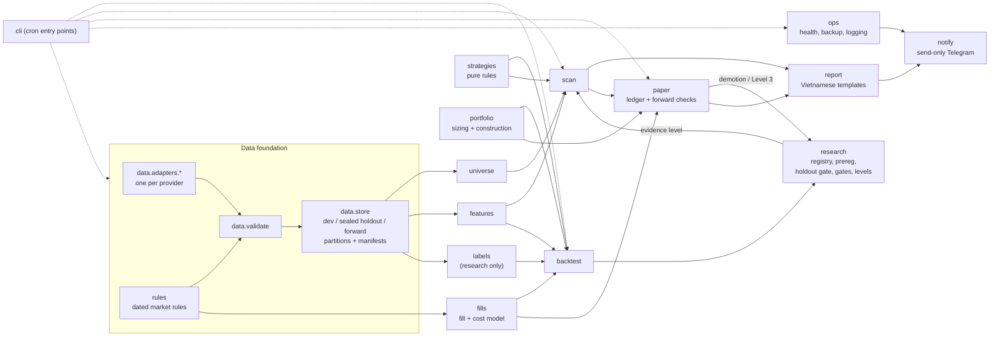
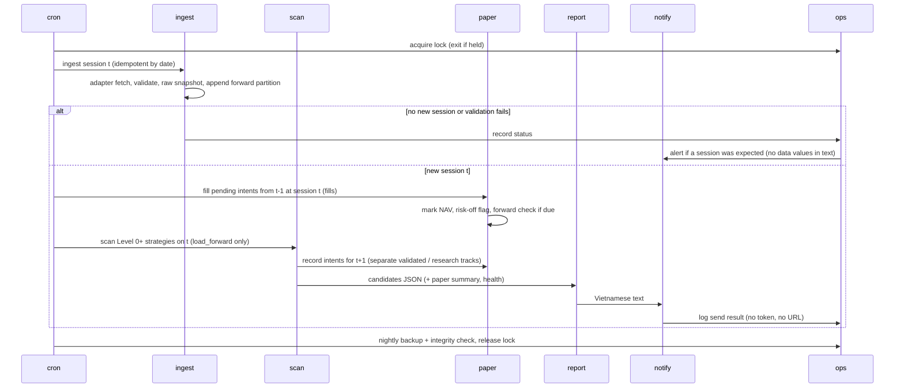

# Architecture (MVP)

Status: proposed, Phase 0. The decision, the alternatives and the deferred list live in [ADR 0001](decisions/0001-mvp-architecture-and-storage.md). This document holds the design only. Nothing here is built, installed or configured yet.

Tags follow the Phase 0 global constraints. Unlabelled structure is the designer's choice. `[Owner decision needed]` marks the material choices, and the ADR lists them as O1–O7.

## Scope

- **In:** end-of-day ingestion through source adapters, point-in-time universe and features, a dated rules table, a shared fill and cost model, the backtester, the trial registry, the held-out gate, the daily scan, Vietnamese template reports, a send-only Telegram notifier, a paper ledger, health checks and backups.
- **Out:** ML, agents, an LLM wording layer, interactive bot commands, and any broker connection. The last is never in scope.

## Module diagram



Boundary rules, enforced by one test that scans `src/` (import statements and call sites):
- `scan`, `paper` and `report` never import `labels`, so forward labels cannot leak into live outputs.
- `strategies` imports nothing from `data`, `notify` or the network.
- Only `data.adapters.*` and `notify` open network connections.
- `backtest` and `paper` both call `fills` and `portfolio`. Neither carries its own fill, sizing or construction code.
- Only `data/store.py` reads the market-data and series files. File I/O is checked by an AST call-site scan, not a text grep.
  - **How the scan works.** The test parses every module in `src/` with the stdlib `ast` module. It fails on any file-I/O call site in a module that is not on the allowlist below. File-I/O call sites are:
    - calls to `open`, `io.open`, `os.open`, `os.listdir` and `os.scandir`;
    - any `glob` call, and `Path.open`, `read_text`, `read_bytes`, `write_text`, `write_bytes`, `iterdir` and `glob` on a path;
    - `read_parquet`, `read_csv`, `read_table`, `ParquetFile`, `np.load`, `pickle.load` and `shutil` copy functions;
    - `sqlite3.connect`, and `subprocess` calls.

    Importing `pyarrow`, `duckdb`, `pickle` or `glob` outside the allowlist also fails. `urlopen` is not file I/O; network calls are covered by the network rule above. The scan does not care how a path string is built, so `"var" / "sealed"` cannot evade it. A plain text check for `sealed` outside `data/store.py` is kept as an extra tripwire.
  - **Allowlist.** It is enumerated in the test and reviewed on every change:

    | Module | Permitted I/O |
    |---|---|
    | `data/store.py` | Every `var/` data file: raw, dev, sealed, forward, seed, series and reports |
    | `config.py` | `config/` and `.env` |
    | `ops/db.py` | `sqlite3.connect` to `var/state.sqlite`; every other module reaches SQLite through it |
    | `ops/log.py`, `ops/lock.py` | `var/logs/` and the lock file |
    | `ops/backup.py` | The SQLite backup API and `rsync` subprocess calls; it never parses Parquet content |
    | `research/prereg.py` | `research/prereg/` and `git` subprocess calls |
    | `ops/health.py` | `git` subprocess calls and disk-free checks |
  - **Who may call `load_forward`.** Only `scan` and `paper` may call `store.load_forward`. Only `research.holdout` may call `load_holdout`. Only `research` and `paper.forward_check` may call `load_series`. The same AST scan enforces all three.

  See `## Data lineage and read paths`.

## Module responsibilities

| Module | Responsibility | Must not |
|---|---|---|
| `config` | Load `config/*.toml` (stdlib `tomllib`) and `.env`; validate them; expose an immutable settings object and its hash. | Log secret values. |
| `data.adapters.<provider>` | Fetch EOD bars, corporate actions and listings from one provider. Declare its four permissions, rate limit and field definitions. | Be imported by anything except `data.ingest`. Hard-code credentials. |
| `data.validate` | Check schema, OHLC consistency, duplicates, calendar gaps and price-band breaches (using `rules`); flag rather than repair. | Silently fill or alter values. |
| `data.store` | Write immutable raw snapshots and the dev, sealed holdout and forward partitions with manifests; the only reader of Parquet, through `load_dev`, `load_forward`, `load_holdout(token)` and `load_series(kind, id, expected_hash)` for trial OOS and look H series, which refuses on a hash mismatch (`## Data lineage and read paths`). | Overwrite a snapshot. Open any path under `var/sealed/` without an unmask token. |
| `rules` | Dated table of exchange parameters by (exchange, date), with status (verified, Assumption, Unverified) and conservative fallbacks (quant-methodology.md `## Execution and fill model`, "Rule as of date"). | Contain undated "current" values. |
| `universe` | Point-in-time eligible list (quant-methodology.md `## Universe`). | Use future listings or status. |
| `features` | Deterministic features stamped with their availability session. | Use data after *t*. |
| `labels` | Forward labels for research. | Be visible to `scan`, `paper` or `report`. |
| `strategies` | Pure rule definitions, parameters and the ranking score definition. | Fetch data, read the clock, or call an LLM. |
| `fills` | Fill rules 1–8, cost model and slippage, ATO baseline and ATC sensitivity, `rule_unverified` flags. | Differ between backtest and paper. |
| `portfolio` | Intent sizing (Q = min(P_d ÷ price, c_open × 20-session median volume), lot rounding), K, P_d = NAV_d ÷ K, sector cap, the top-2K hold buffer, the *h* + s cycle and settled-cash funding (quant-methodology.md `## Default risk settings`, portfolio construction; `## Execution and fill model` rules 3 and 6). | Differ between backtest and paper. |
| `backtest` | Daily long-only loop that calls `portfolio` for intents and `fills` for executions. | Optimise silently. Run without writing a registry row. |
| `research` | Trial registry, pre-registration hashing, the held-out gate and look counter, gates G1–G12, evidence levels, research summaries. | Delete or update registry rows. |
| `scan` | Run Level 0+ strategies on the latest forward session (`load_forward`); emit structured candidates (JSON) split by evidence level. | Invent missing values. Place a Level 0–1 candidate in the validated section. |
| `report` | Turn candidate JSON into Vietnamese text with standard-library string templates. | Change, round away or add numbers beyond the stated formatting. |
| `paper` | Size hypothetical intents from each shortlist with `portfolio`; price them with `fills`; keep the append-only ledger; compute NAV; run the Level 3 and demotion checks. | Send anything to a broker. Edit past events. Read data except through `load_forward`. |
| `notify` | POST the rendered report to allowlisted chat IDs; dry-run to file. | Receive commands (MVP). Log the request URL. |
| `ops` | Logging with redaction, the job lock, health signals, backup and restore checks. | Print secrets. |
| `cli` | One subcommand per job (`ingest`, `scan`, `paper`, `send`, `daily`, `health`, `backup`, `backtest`, `holdout`, `redact`, `alert`). | Hold business logic. |

## Where the methodology lives

| quant-methodology.md mechanism | Home | Storage |
|---|---|---|
| Dated rules table, conservative fallbacks (`## Execution and fill model`) | `rules` | `config/market_rules.csv`, versioned in git; each row carries exchange, parameter, valid_from, valid_to, value, status and source reference |
| Fill rules 1–8, cost model, ATC sensitivity | `fills` | Code; parameters in `config/settings.toml` |
| Trial registry (`## Validation design`) | `research.registry` | SQLite table `trials`, append-only and hash-chained (`## Storage layout`). Row fields: trial_id, hypothesis_id, strategy_id, version, config_hash, settings_hash, data_version, code_version, created_at, `robustness` (true for pre-registered robustness reruns, which do not count in N_trials), summary metrics, `oos_series_path`, `oos_series_hash` (SHA-256 of the daily OOS net-excess Parquet), prev_hash, row_hash |
| Pre-registration record | `research.prereg` | `research/prereg/<hypothesis_id>-v<version>.toml`, committed to git; hash and `prereg_commit` indexed in SQLite |
| Held-out masking loader | H is a physically separate, sealed partition; `data.store.load_holdout(token)` opens it, and `research.holdout.unmask()` issues the only token after the checks in `## Data lineage and read paths` | *t*_H and T_snap fixed in the lineage manifest |
| H-look counter | `research.holdout` | SQLite `holdout_looks`: one append-only, hash-chained row per look (look_id, hypothesis_id, prereg hash, `prereg_commit`, batch hashes, created_at, `series_hashes`). The family's count is COUNT(*) of its rows; the check and the INSERT share one `BEGIN IMMEDIATE` transaction before any H data is returned |
| H net-excess series (input to the Level 3 and demotion bootstrap) | `research.holdout` | `var/research/looks/<look_id>/<config_hash>.parquet`, one per batch run; each SHA-256 is stored in the look row's `series_hashes` and verified on every read |
| Gates G1–G12, `gates_version` | `research.gates` | `config/gates_v1.toml`, hashed; never edited after freezing |
| Evidence levels, demotion | `research.levels` | SQLite `level_events`, append-only and hash-chained, keyed by (strategy_id, version). A version with no events is Level 0; a new version never inherits a level. Each promoting event must carry its evidence: → 1 a trial_id; → 2 the passing trial_ids, `gates_version` and look_id; → 3 or a demotion a forward-check id and the look_id whose H series it used. `scan` re-verifies these references (rows exist, the hashes match, `gates_version` equals the hash of the gates file in force, and the trial's config hash is in the look's batch) before it places a strategy in the validated section. A family gets only one H look, so a later version of that family can reach Level 2 or 3 only through forward paper data or a new held-out period of fresh data (quant-methodology.md `## Validation design`, held-out looks) |
| Default risk settings (`## Default risk settings`) | `config/settings.toml` → `config` | Settings hash recorded in each trial row and pre-registration record |
| Level 2 → 3 and demotion checks (`## Pass/fail gates`) | `paper.forward_check` | Runs every 20 forward sessions on the `validated` track; bootstraps from the H series of the strategy's look, read through `store.load_series` with the hash from the look row; writes `level_events` |
| Risk-off flag (NAV ≥ 15% below peak) | `paper` → `report` | Derived from the ledger |

## Data flow: the daily job



- **Run time.** One cron entry on weekdays at a configured local time after EOD data is published. The publication time per source is `[Unverified → P1 check: when each candidate's EOD data for session t becomes final]`. The machine timezone is Asia/Ho_Chi_Minh (ADR 0001 S1). Every stored timestamp is ISO 8601 with +07:00.
- **Idempotency.** Each job is keyed by session date. A rerun for the same date either finds existing outputs and exits, or re-runs with `--force`, which writes a new version and never overwrites.
- **Order of paper steps.** Intents created at *t* are filled only after session *t*+1 data arrives, using that session's open (baseline) and close (ATC sensitivity). The intent row is written before *t*+1 data exists, which is what makes the record look-ahead-free.

## Storage layout

All runtime data lives under `var/`, which is gitignored. Phase 1 adds `var/` to `.gitignore`, which today lists `.env`, `.venv/` and `__pycache__/`.

```
var/
  raw/<source>/<fetch_date>/<dataset>.parquet   # immutable, as received, plus request metadata
  lineage/<lineage>/manifest.json               # source, T_snap, t_H, N, W_max, survivorship +
                                                # adjustment status, permissions, partition hashes
  curated/<data_version>/dev/*.parquet          # sessions < t_H (D + gap): adjusted + raw,
                                                # corp actions, listings
  sealed/<lineage>/holdout/*.parquet            # sessions t_H..T_snap, mode 0400, unmask only
  forward/<lineage>/<session_date>.parquet      # sessions > T_snap, one immutable file each
  forward/<lineage>/_lookback_seed.parquet      # last W_max sessions of H, price columns only
  research/trials/<trial_id>.parquet            # daily OOS net-excess series
  research/looks/<look_id>/<config_hash>.parquet  # daily H net-excess series per look
  reports/<session_date>/{candidates.json,report.vi.txt}
  state.sqlite                                  # all state (WAL mode)
  logs/vnsi.log                                 # rotated by the stdlib handler
  backups/                                      # local staging; copied off-disk (ADR O6)
```

- **Permission gate.** A source whose storage permission is not verified writes to `var/raw/` only if the owner approves interim research use (ADR O2). Its data versions carry `research_only = true`, and every report built on them says so in the header. (Owner decision 1; data-sources.md `## Recommendation`)
- **SQLite tables:** `trials`, `holdout_looks`, `prereg_index`, `level_events`, `paper_events`, `job_runs`, `send_log`. The first five are append-only: triggers reject UPDATE and DELETE `[Assumption: SQLite BEFORE UPDATE/DELETE triggers with RAISE(ABORT) behave this way; P1 check against the SQLite docs]`.
- **Hash chains.** `trials`, `holdout_looks`, `level_events` and `paper_events` each carry `prev_hash` and `row_hash` (SHA-256 over the row's canonical JSON plus `prev_hash`). Triggers can be dropped and any local process can write the file, so the chains are what detects edits. Nightly, each chain head (table, row count, head hash) is written to the backup manifest that is copied off-disk, and appended to `research/chain_heads.log`, which is git-tracked and committed when the owner commits. Git protects it only once a line is committed. Uncommitted lines are normal between commits, and the off-disk manifest covers that gap. `/health` therefore flags the log as stale only when its oldest uncommitted line is more than 7 days old. The 7 days are a judgement call `[Assumption]`: they allow a weekly commit habit and bound the window in which git offers no protection. The log is outside the paths that unmask check 3 hashes, so neither the nightly append nor a commit of the log affects a look (`## Data lineage and read paths`). `/health` recomputes every chain and checks that the current chain extends the last off-disk head, so truncating the tail is also detected. This is tamper-evident, not tamper-proof, which is acceptable for a solo owner.
- **Paper ledger.** `paper_events` stores one row per event: intent, fill, partial, cancel, exit, forced_exit, mark or missed. Each row holds strategy id and version, evidence level at intent time, `track` (`validated` or `research`), data_version, the prices and volume used, the flags from `fills`, and `prev_hash` plus `row_hash` (SHA-256), which make up a hash chain. Positions and NAV are derived from the events and never stored as mutable rows.

## Data lineage and read paths

- **Lineage.** The first verified full-history snapshot (step 5) opens a lineage and fixes its last session T_snap, N and *t*_H. They never change within the lineage. A corrected re-fetch of the same history gives a new dev `data_version` inside the lineage only if T_snap and *t*_H stay the same. Anything else is a new lineage, which needs owner approval. Trial counts and look counts are global and are never reset by a new lineage.
- **Three partitions, physically separate and disjoint in time:**

| Partition | Sessions | Path | Only reader |
|---|---|---|---|
| dev | first session to *t*_H − 1 (D plus the 31-session gap) | `var/curated/<data_version>/dev/` | `store.load_dev()` |
| holdout | *t*_H to T_snap | `var/sealed/<lineage>/holdout/` | `store.load_holdout(token)` |
| forward | T_snap + 1 onwards, one file per session | `var/forward/<lineage>/` | `store.load_forward(as_of, lookback)` |

- H ends at T_snap and forward starts at T_snap + 1, so they share no session. Forward sessions are never re-labelled as H for any family whose paper track has already read them.
- **Live read path.** `scan` and `paper` use only `load_forward`, which does not count as an H look and refuses any `as_of` ≤ T_snap.
  - **Lookback seed.** At the lineage cut, `store` writes a derived seed file, `var/forward/<lineage>/_lookback_seed.parquet`. It holds the price columns only (OHLC, volume, reference price) for the last W_max sessions of H. It has no label, return or metric columns.
  - W_max is a constant in the lineage manifest, not a setting. It can be raised only by creating a new lineage. `load_forward` refuses any `lookback` > W_max.
  - The seed's SHA-256 is recorded in the lineage manifest. `load_forward` verifies it on every read and refuses on a mismatch.
  - Features need a lookback of up to W_max sessions. For the first W_max forward sessions, `load_forward` serves the part of the window before T_snap + 1 from the seed file. It never touches `var/sealed/`.
  - Any scan whose window touches the seed is flagged `h_overlap` in its candidates JSON and is logged.
  - Why this overlap is acceptable: the live path computes no labels, returns or metrics on H sessions, and it writes no look row. It therefore reveals no strategy outcome on H.
- **Enforcement.** `load_dev` and `load_forward` refuse any path under `var/sealed/`. The AST file-I/O scan (`## Module diagram`, boundary rules) keeps every other module away from the files. The sealing is code-level only. `var/raw/` keeps the H sessions unsealed from the first snapshot onwards, because raw files are immutable and are the rebuild source. The owner can also open any file with outside tools, so the guarantee rests on the checks below, the look counter and the owner's discipline, as in quant-methodology.md `## Validation design`.
- **Unmask checks.** `research.holdout.unmask(prereg_path, configs)` issues a token only if every check passes. Otherwise it refuses and logs which check failed.
  1. The git object `<prereg_commit>:<prereg_path>` exists (`git cat-file -e`), and its SHA-256 equals the record hash in `prereg_index`.
  2. The configs requested equal the record's `batch` list of config hashes exactly, and all of them run in this single invocation.
  3. `code_version`, `data_version` and `gates_version` equal the record's values. `code_version` is defined over a fixed set of code paths, not as the HEAD commit id. It is the SHA-256 of `git ls-tree -r HEAD -- src config pyproject.toml uv.lock`, and `git status --porcelain -- src config pyproject.toml uv.lock` must print nothing.
     - Commits that touch only `research/chain_heads.log`, `research/prereg/` or `research/summaries/` therefore leave a look valid. Check 1 covers the pre-registration record itself.
     - Any change under `config/`, including settings unrelated to this family, invalidates a pending look. This is the conservative direction, and the fix is to re-freeze the record.
  4. The record's *t*_H equals the lineage manifest's *t*_H.
  5. Inside one `BEGIN IMMEDIATE` transaction, COUNT(*) of `holdout_looks` rows for the family is 0, and the new look row is then inserted. Both happen before any H row is returned.

  The token is bound to the look_id. It is valid only for that process and that batch, and each run's H series is written under that look_id.

## Source adapter boundary

Illustrative only, not project code:

```python
class SourceAdapter(Protocol):
    name: str                        # matches a [sources.<name>] entry in config/sources.toml
    def fetch_eod(self, symbols: list[str], start: date, end: date) -> RawBatch: ...
    def fetch_corporate_actions(self, start: date, end: date) -> RawBatch: ...
    def fetch_listings(self, as_of: date) -> RawBatch: ...
```

```toml
# config/sources.toml (illustrative)
[sources.example_provider]
public_access     = "unknown"   # verified-yes | verified-no | unknown
storage           = "unknown"
automated_access  = "unknown"
redistribution_or_training = "unknown"
evidence          = ""          # link to the P1 check record
min_request_interval_s = 2.0    # from the provider's stated limit, else conservative
fields.open       = "unknown"   # ATO match vs first trade (quant-methodology.md fill model)
```

- **Snapshot strategy.** Daily ingest is incremental: it fetches only the new session or sessions plus that day's corporate actions and listings, then writes one raw file and one forward file. A full-history fetch happens only when a lineage is opened, or on an explicit `vnsi ingest --revalidate` run. That run writes a new raw snapshot, compares it with the stored data and reports differences in `/health`. It never rewrites forward files, and the ledger keeps the prices it actually used.
- **Versions.** A dev `data_version` is `<lineage>-dev-<content hash>`, cut once per lineage or revision. The forward version is `<lineage>-fwd-<last session>`, and the lineage manifest lists the hash of each forward file.
- `data.ingest` refuses to tag a data version as production unless both `storage` and `automated_access` are `verified-yes`.
- A `fixture` adapter reads small, hand-written test files that are labelled as synthetic. Tests use it, and it never feeds a report.
- Provider client libraries are not dependencies by default. An adapter uses stdlib HTTP unless a client is approved after a supply-chain review. vnstock 4.0.8 is quarantined on PyPI pending a security review (data-sources.md `## Headline findings` 4), and its licence covers the software, not the data (`## Headline findings` 3).

## Repository layout

```
pyproject.toml, uv.lock
config/
  settings.toml          # risk defaults, schedule, paths, P, K, costs (non-secret)
  sources.toml           # per-source permissions + limits
  market_rules.csv       # dated rules table
  gates_v1.toml
research/
  prereg/                # committed pre-registration records
  summaries/             # research summaries per hypothesis (Markdown)
src/vnsi/
  config.py  rules.py  universe.py  features.py  labels.py
  fills.py  backtest.py  scan.py  paper.py  notify.py  cli.py
  data/      adapters/{base.py,fixture.py,<provider>.py}  ingest.py  validate.py  store.py
  strategies/  <one file per hypothesis family>
  research/  registry.py  prereg.py  holdout.py  gates.py  levels.py
  report/    vi.py
  ops/       db.py  log.py  lock.py  health.py  backup.py
tests/       mirrors src/vnsi; fixtures/ synthetic data only
var/         runtime data (gitignored)
```

Modules start as single files and are split only when they grow. The package name `vnsi` is a placeholder.

## Configuration and secrets

- **Non-secret settings** go in `config/*.toml`, versioned in git. The settings hash is recorded in every trial row, pre-registration record, ledger event and report footer.
- **Secrets** go only in `.env`, which is already gitignored, with mode 0600. They are read by a few lines of stdlib parsing; no python-dotenv.

  ```
  # .env (illustrative names, no values)
  TELEGRAM_BOT_TOKEN=
  TELEGRAM_ALLOWED_CHAT_IDS=        # comma-separated integers; the send allowlist
  SOURCE_<NAME>_API_KEY=            # only if an approved source needs one
  ```
- **Allowlist.** In the MVP, `notify` sends only to chat IDs in `TELEGRAM_ALLOWED_CHAT_IDS` and refuses to start if the list is empty. Later, the interactive bot also drops every incoming update whose user ID is not on the list, and its access decisions are logged without message content.
- **Startup check.** `config` refuses to start if `.env` is group- or world-readable, or if any secret value appears in a tracked file.
- **No paid keys.** There is no setting for any LLM or paid API. Adding one requires owner approval (Owner decision 5).

## Logging

- Standard-library `logging`, one rotating file (30 files kept).
- **What is redacted.** The values of `.env` keys ending in `_TOKEN`, `_KEY`, `_SECRET` or `_PASSWORD`, and anything matching a Telegram-token-shaped pattern, are replaced with `***`. Non-secret values such as chat IDs are not redacted. They are still not logged per message: the send log records only a count of recipients.
- **Where it applies.** The redaction runs as a filter on the root logger, covering messages, arguments and formatted tracebacks. Uncaught exceptions bypass logging, so `cli.main()` also redacts them: before doing anything else it replaces `sys.stderr` and `sys.stdout` with a redacting wrapper and installs `sys.excepthook`, which logs the redacted traceback and exits non-zero. Cron mail is just the process's stdout and stderr, so it receives only redacted text.
- **Below Python.** C-level writes to fd 2 and `faulthandler` output bypass the Python wrapper. The crontab therefore sets `MAILTO=""` and leaves `PYTHONFAULTHANDLER` unset. It runs `vnsi daily 2>&1 | vnsi redact >> var/logs/cron.log || vnsi alert redact-failed`, where `vnsi redact` is a stdin filter that uses the same redaction function, so fd-level output is also redacted before it is stored.
  - **Filter failure.** If the filter itself fails, it writes the rest of the stream to a mode-0600 quarantine file under `var/logs/quarantine/`, which is never mailed or sent. It also writes a one-line notice to the log and exits non-zero. In `/bin/sh` a pipeline's exit status is that of its last command `[Assumption]`, so the `||` branch sends a data-free alert.
  - **Job failure.** A failure of `vnsi daily` itself is recorded in `job_runs` and caught by `/health`, because `/bin/sh` may not support `pipefail` `[Assumption]`.
- The Bot API puts the token in the request URL path `[Unverified → P1 check: Telegram Bot API docs, request URL format]`. `notify` therefore never logs the URL, and it wraps network errors so the exception text, which can contain the URL, passes through redaction before logging.
- Telegram alerts carry a job name, session date and error class only, never tracebacks or data values.
- Acceptance test, step 12 (when `send` exists): run `vnsi send` as a subprocess, the way cron does, with a dummy token and a forced network failure, and separately with an uncaught exception raised after the token is loaded. In both cases the token must not appear in the log file, the captured stdout and stderr (what cron would mail), or the alert text. A chat ID still appears where it is logged on purpose.

## Backup and recovery

| Asset | Replaceable? | Backup | Recovery |
|---|---|---|---|
| `state.sqlite` (registry, look counter, ledger, levels) | **No.** Forward paper time cannot be regenerated. | Nightly online copy with the stdlib `sqlite3` backup API `[Assumption: sqlite3 Connection.backup produces a consistent copy of a WAL-mode database while no writer holds the lock; P1 check against the Python docs]`, then `PRAGMA integrity_check` on the copy. A backup manifest records each chain head. Keep 14 daily and 12 monthly copies; the database is small, so full copies are cheap `[Assumption]`. Copy to the off-disk destination (ADR O6). | Restore the latest copy that passes the check; verify every hash chain against the off-disk heads; replay the missing days from stored reports (below). |
| `var/reports/<date>/candidates.json` | No; it is the time-stamped intent record. | Included in the nightly copy. | Source for rebuilding `paper_events` intents deterministically. Fills are recomputed with `fills` from the stored data version. |
| `var/raw/`, `var/forward/`, `var/sealed/`, `var/research/` | Raw only if the source still serves the same history, which is not guaranteed. Forward files are the fill record. | Incremental nightly copy with rsync, which is installed (observed, ADR 0001 S1), to the same destination. The files are immutable, so only new files are sent; Parquet is never fully re-copied each night. Kept indefinitely; EOD volume is small `[Assumption]`. | Copy back and verify each file against the lineage manifest and registry hashes. |
| `var/curated/` dev partitions | Yes, from raw. | Not required. | Rebuild and verify against the manifest hash. |
| `config/`, `research/prereg/`, code | Yes. | Git; push to a remote only with owner approval. | Checkout. |

- **Restore drill.** Restore into a temporary directory monthly and after every schema change. The check: the integrity check passes, and every chain head equals the head in that night's off-disk backup manifest.
- **Tamper evidence.** The four hash chains and their off-disk and git-tracked heads (`## Storage layout`) detect edits and truncation. They do not prevent them.

## Health signals

In the MVP these are computed by `vnsi health`, appended as a short footer to each daily message, and sent as a separate alert on failure. They become the `/health` command later.

| Signal | Healthy when |
|---|---|
| Last successful ingest | The session date equals the latest expected session per the trading calendar |
| Data freshness | The fetch timestamp is after the configured publish time for that session |
| Source and permission status | Shows the source name; `research_only` is shown prominently when true |
| Validation | Zero blocking errors; the count of flagged rows is shown |
| Scan and paper jobs | Status `ok` for session *t*; pending intents filled or explicitly cancelled |
| Hash chains (`trials`, `holdout_looks`, `level_events`, `paper_events`) | Each verifies end to end and extends the last off-disk head. If the off-disk destination is not mounted, the signal fails with "off-disk heads unavailable". It still checks the chains against the last committed line of `research/chain_heads.log` and says which reference it used. |
| Chain-heads log | No uncommitted line is older than 7 days (`## Storage layout`, hash chains) |
| Backup | The last backup is under 26 hours old, passed the integrity check, and reached the off-disk destination. An unmounted destination fails this signal and names the missing mount point. |
| Disk free | Above a configured floor |
| Versions | Git commit (with a dirty-tree flag), settings hash, data_version, gates_version |
| Rule uncertainty | Share of today's paper fills with `rule_unverified` |
| Last send | Telegram send status and time, with no message content |

## Telegram scope

- **MVP (send-only).** One daily message to allowlisted chats, with a single fixed section order:
  1. Header with as-of time, data freshness, source, and the research-only data label if applicable.
  2. **Validated signals (Level 2+)**, or, if there are none, the statement "Không có chiến lược nào đạt mức kiểm chứng" (no strategy has reached the validated level) and a pointer to the latest research summary. This statement comes first, per spec §5.
  3. **Research candidates — chưa được kiểm chứng**, each with the spec §5 fields.
  4. Paper tracking: open positions, NAV against the benchmark, and the risk-off flag, shown separately for the `validated` and `research` tracks.
  5. Any demotions.
  6. Health footer.

  Messages over the API's length limit are split at section boundaries `[Unverified → P1 check: Telegram Bot API sendMessage text length limit]`.
- **Later milestones** (Task 7 numbers them; all are within Phase 5 unless noted):

| Command | Milestone | Note |
|---|---|---|
| `/start`, `/help`, `/health` | Phase 5, first step (interactive read-only) | Needs update polling and an incoming user-ID allowlist check. No inbound port: long polling only. |
| `/scan` | Phase 5, first step | Returns the latest stored shortlist. It never triggers a fresh, unscheduled run. |
| `/market` | Phase 5, after `/scan` | Reads curated index and breadth data. |
| `/analyze TICKER` | Phase 5, after `/market` | Reads stored features and candidate history for one ticker. Input is validated against the universe. |
| `/watchlist` | Phase 5, last step | First command that writes state. Uses the job lock or short transactions (ADR 0001 Consequences). |
| `/backtest` | Phase 5, last step, read-only | Shows registry results only. Running a new trial from chat is not offered, because every run counts in N_trials and H looks must go through `vnsi holdout` with a committed pre-registration. |

## Dependencies

All are to be installed in Phase 1, pending approval (ADR O5). Nothing is installed now.

| Package | Use | Licence |
|---|---|---|
| pandas | Tabular transforms, backtest loop data | BSD-3-Clause `[Unverified → P1 check: confirm in the project repository]` |
| pyarrow | Parquet read and write | Apache-2.0 `[Unverified → P1 check: confirm in the project repository]` |
| pytest (dev) | Tests | MIT `[Unverified → P1 check: confirm in the project repository]` |

Everything else comes from the standard library: `sqlite3`, `tomllib`, `urllib.request`, `logging`, `hashlib`, `string.Template`, `zoneinfo` and `fcntl`. `tomllib` and `sqlite3` are present on the owner's Python 3.11 (ADR 0001 S1). The lock is `fcntl.flock` on a lock file; the kernel releases it when the process exits, so a crashed job leaves no stale lock `[Assumption: Linux flock semantics; P1 check against the Python and Linux docs]`. The state file runs in SQLite WAL mode `[Assumption: WAL allows readers during a write and survives process crashes; P1 check against the SQLite docs]`. NumPy arrives as a pandas dependency `[Assumption]`. The bootstrap tests for G2, G4 and the forward check are written against it, not against an extra statistics library. Scheduling uses the system cron (ADR 0001 S1).

## Shortest credible path

Each step ends with an acceptance check, and no step begins before the previous one passes. Steps 1–6 fall in Phase 1, steps 7–10 in Phase 2, and steps 11–15 are the minimal Phase 5 and 6 slice pulled forward before Phase 3 (ADR O3). Task 7 turns these into roadmap milestones. Every phase transition still needs explicit owner approval (CLAUDE.md).

Separation rule, applied throughout: every candidate, ledger row and report line carries `evidence_level` and `track`. Only Level 2+ produces `track = validated`. Research data is labelled at the data-version level as well.

1. **Skeleton.** Create the uv project, package layout, `config` loader, `.env` permission check, redacting logger, job lock and `var/` gitignore entry. *Accept:* `uv run pytest` passes the redaction filter test and an excepthook case, in which `vnsi health` runs as a subprocess with a dummy token and a forced uncaught exception, and the token is checked absent from the log, stdout and stderr; it also passes the boundary-rule test, including the AST file-I/O scan; `vnsi health` runs on empty state and reports "no data".
2. **Dated rules table.** Encode quant-methodology.md `## Market rules` as `config/market_rules.csv`, with status and source on each row. *Accept:* tests return the correct value at both sides of each change date (for example settlement on 2022-08-29) and the conservative value with `rule_unverified` for Assumption- and Unverified-tagged rows.
3. **Adapter boundary and validation.** Build the `SourceAdapter` interface, the `fixture` adapter, `data.validate` and `config/sources.toml`. *Accept:* contract tests pass on the fixture; validation flags crafted bad rows (high < low, duplicate session, band breach, calendar gap) without altering them; ingest refuses production tagging while permissions are `unknown`.
4. **P1 verification of candidate sources (gate).** Run data-sources.md `## P1 checks (consolidated)` 1–10 and the read-only P1 checks from quant-methodology.md (open-field meaning, volume composition, publish time). Do a supply-chain review before installing any provider client. Any sign-up, such as an SSI key, needs owner approval first. *Accept:* each candidate's `sources.toml` entry has evidence for all four permissions. If no source reaches `verified-yes` for storage and automated access, stop and report. The pipeline then continues only as research-only under ADR O2.
5. **Ingest and store.** Write the adapter for the selected source, raw snapshots, the lineage cut (dev, sealed holdout and forward partitions), manifests with T_snap, *t*_H and N, and the four loaders `load_dev`, `load_forward`, `load_holdout` and `load_series` (`## Data lineage and read paths`). *Accept:* rerunning ingest for a date is a no-op; rebuilding dev from raw reproduces the manifest hash; `load_dev` and `load_forward` refuse any path under `var/sealed/`; `load_forward` refuses an `as_of` ≤ T_snap and reads only forward files and `_lookback_seed.parquet`; the seed has only price columns and exactly W_max sessions; a scan that touches the seed is flagged `h_overlap`; `load_forward` refuses a lookback > W_max and a seed whose hash does not match the manifest; N ≥ 1,600 is checked and reported (quant-methodology.md `## Validation design`).
6. **Universe and features.** *Accept:* a perturbation test, where changing any data after *t* leaves the universe and features at *t* unchanged; universe counts per session are reported together with the survivorship label.
7. **Fill and cost model (`fills`).** *Accept:* hand-computed unit tests for rules 1–8 (limit-locked open gives no fill, participation cap, lot rounding, settlement-delayed exit, terminal haircut) and the cost model, at both baseline and ATC.
8. **Backtester and research spine.** Build `portfolio`, the backtest loop, the trial registry, pre-registration hashing, the held-out gate with its look rows and H series storage, gates G1–G12 and level events. *Accept:* every run writes exactly one registry row, with its `robustness` flag and series hash; UPDATE and DELETE fail on every append-only table, and a row edited outside the code breaks its hash chain (tests); unmask refuses on each of the five checks failing in turn; one look inserts exactly one `holdout_looks` row per batch; a new strategy version starts at Level 0 even when an earlier version is at Level 2 (test); a level event lacking its evidence references, or whose `gates_version` does not match, keeps the strategy out of the validated section (test); gates are computed on synthetic fixtures with known answers.
9. **Run the hypothesis backlog on D.** *Accept:* a research summary per hypothesis in `research/summaries/` with verdict text in the quant-methodology.md `## Pass/fail gates` format, and family and global trial counts. "No strategy passes" is an acceptable outcome.
10. **CLI daily scan.** `vnsi scan --date t` writes `candidates.json` with separate `validated` and `research` arrays. *Accept:* a test that a Level 0–1 strategy cannot place a candidate in `validated`; with no Level 2+ strategy the JSON leads with `no_validated_strategy = true` and the summary link; every spec §5 field is present or explicitly `missing` with a warning.
11. **Vietnamese templates.** *Accept:* a number-consistency test, where every number in the text appears in the JSON; the research section heading includes "chưa được kiểm chứng"; the section order from `## Telegram scope` is fixed; output is split at section boundaries when over the limit.
12. **Send-only notifier.** *Accept:* it refuses to run with an empty allowlist; dry-run writes the exact payload to `var/reports/`; one real message reaches the owner's chat (manual check). That message is a synthetic test rendered from the fixture adapter and headed "TIN NHẮN THỬ — dữ liệu giả lập, không phải tín hiệu" (test message, synthetic data, not a signal), so the check never depends on ADR O2(b). The full `## Logging` acceptance test passes for `vnsi send`.
13. **Schedule, health and backup.** Precondition: ADR O6 is decided and the off-disk destination is mounted. Add `vnsi redact`, `vnsi alert`, the cron entry for `vnsi daily` (ingest, scan and send), failure alerts, the nightly backup with chain heads, and the restore drill. *Accept:* the exact cron pipeline, run in a test shell, gives these results:
    - a dummy token written to fd 2 by a child process does not appear in `cron.log`;
    - a forced crash inside `vnsi redact` still leaves the output in the quarantine file, puts a notice in `cron.log` and sends the `redact-failed` alert, so the failure is never silent;
    - a skipped session triggers a freshness alert; a restore into a temporary directory passes the integrity check and matches every chain head in the off-disk manifest; 10 consecutive unattended sessions complete (the burn-in length is a judgement call `[Assumption]`).
14. **Paper ledger.** It is added to `vnsi daily` and runs only from cron, never as an unscheduled manual run; a manual `--force` rerun for a past date may fill existing intents but never create new ones. *Accept:* intents from the *t* shortlist are written before *t*+1 data exists (the timestamp is checked against the forward file's fetch time); sizing comes from the same `portfolio` call and fills from the same `fills` call as the backtester, and a test feeding both paths the same inputs gets identical intents (quantities, K, cash) and identical fills; the hash chain verifies; `validated` and `research` tracks are reported separately; the risk-off flag triggers at a 15% drawdown on a synthetic NAV; the first nightly backup after the first ledger event reaches the off-disk destination.
15. **Forward checks.** Run the Level 3 and demotion checks every 20 forward sessions for `track = validated` only (quant-methodology.md `## Pass/fail gates`, Level 2 → 3). *Accept:* tests on synthetic forward series hit both the promote and demote branches; a check refuses an H series whose hash does not match its look row; a demotion appears in the next report; research-track results are never read by the check (test).

The **first useful shortlist** arrives with step 13, when the scheduled daily send starts on real data, subject to ADR O2(b). Until a strategy reaches Level 2 it will most likely hold only research candidates under the "no validated strategy" header, which spec §5 explicitly allows. **Paper tracking** begins at step 14, already scheduled and backed up off-disk.

## Known limitations

- EOD-only fills inherit every proxy listed in quant-methodology.md `## Execution and fill model` (inputs EOD data lacks).
- Rebuilding the ledger from stored reports depends on the raw snapshots for the fill sessions surviving. If a source later revises history, the rebuilt fills use the stored snapshot, not the revision.
- A single machine with no off-disk copy is a single point of failure until ADR O6 is decided. The ledger step waits for O6 (step 14 precondition).
- **A missed cron day loses that day's intents permanently.** They cannot be created afterwards without look-ahead, because the later sessions are already known. The ledger records a `missed` event for the session, and `/health` shows it.
- Append-only enforcement is tamper-evident, not tamper-proof (`## Storage layout`, hash chains).
- For the first W_max forward sessions, scans read lookback prices from the H seed file and are flagged `h_overlap` (`## Data lineage and read paths`). No outcome is computed on them, but the prices are visible.
